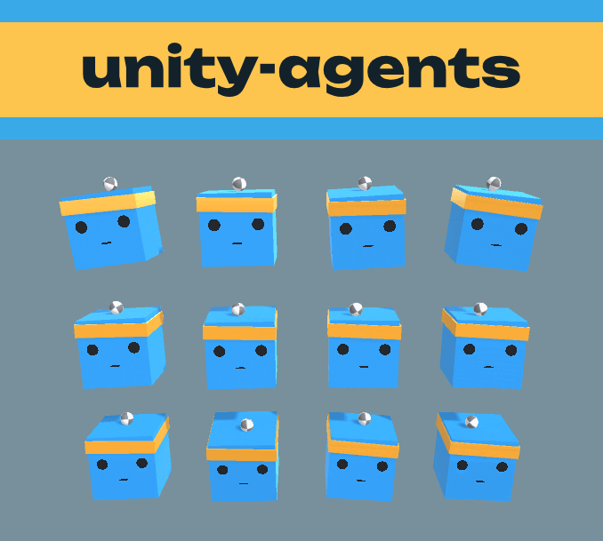

<p align="center">
  
</p>

<p align="center">
  
</p>

Can PPO hyperparameters predict how many training steps a Unity ML-Agents run needs to reach a mean reward threshold? Group 10, BCS2720 Project 2-1 (AI and Machine Learning), Maastricht University. A work in progress.

## Contents

- [Research questions](#research-questions)
- [Layout](#layout)
- [Getting the code](#getting-the-code)
- [Training runs](#training-runs)
  - [Setup](#setup)
  - [Running a training run](#running-a-training-run)
  - [Viewing results in TensorBoard](#viewing-results-in-tensorboard)
  - [Logging a training run](#logging-a-training-run)
- [Automated Training & Data Collection](#automated-training--data-collection)
  - [Building and Specifying a Unity Environment](#building-and-specifying-a-unity-environment)
  - [Running a Single Automated Training Run](#running-a-single-automated-training-run)
  - [Running a hyperparameter batch](#running-a-hyperparameter-batch)
- [Paired batches](#paired-batches)
- [Analysis](#analysis)
- [License](#license)

## Research questions

Main question:

> To what extent can hyperparameter configurations predict the number of training steps required to meet a particular mean reward threshold in Proximal Policy Optimization (PPO) training runs?

Sub-questions:

1. Which PPO hyperparameters have the greatest influence on the predicted number of training steps required to reach the selected reward threshold?
2. How accurately can different machine learning approaches, particularly MLP regression and random forest regression, predict the number of training steps required to reach the selected reward threshold?
3. To what extent can we reliably evaluate these predictions while accounting for variation between training runs and potential confounding factors?

For now, our forest predicts whether a run reaches the threshold within its budget (`reached_95`). The random forest regression comes later.

## Layout

```
docs/
  reading/       notes on the papers
  runs/          training runs
  hardware/      machine register
  shared-data/   analysis of last year's group datasets
  resources/     official materials
tools/           scripts
analysis/        ML code and its pinned requirements
  core/          code shared by the experiments
  datasets/      scripts that build data/
  forest/        our ID3 forest, its runner and its tuner
  mlp/           our MLP, its runner and its tuner
  configs/       experiment settings, one TOML file per experiment
  results/       what each experiment wrote
data/            our run log and the datasets built by analysis/datasets/
  configs/       ML-Agents config of each logged run
  curves/        training curve of each logged run
builds/          Unity environments for automated runs
external/
  ml-agents/     our ML-Agents fork
  BCS2720-project-data-collection/   the course's shared group data
```

## Getting the code

Clone with the submodules:

```powershell
git clone --recurse-submodules https://github.com/qnicondavid/unity-agents.git
```

If you cloned before the data submodule was added, fetch it with:

```powershell
git submodule update --init
```

## Training runs

### Setup

1) Create the virtual environment (Python 3.10) inside the ML-Agents submodule:

   ```powershell
   cd external\ml-agents
   C:\path\to\python310\python.exe -m venv venv
   .\venv\Scripts\Activate.ps1
   pip install setuptools==81.0.0
   pip install torch==2.8.0
   pip install -e .\ml-agents-envs
   pip install -e .\ml-agents
   pip install psutil==7.2.2
   ```

   The scripts in `tools/` also run in this environment. Keep torch at 2.8.0. From 2.9 on, torch exports models to ONNX in a way ML-Agents 1.0.0 does not support: every run ends with an error, and `tools/collect_run.py` does not log it.

2) Unity: open `external\ml-agents\Project` with editor **2022.3.4f1**.

### Running a training run

```powershell
cd external\ml-agents
Set-ExecutionPolicy -Scope Process -ExecutionPolicy Bypass -Force
.\venv\Scripts\Activate.ps1
mlagents-learn config/ppo/3DBall.yaml --run-id=<name>
```

Wait for `Start training by pressing the Play button`, then press Play in Unity.

### Viewing results in TensorBoard

```powershell
tensorboard --logdir results
```

### Logging a training run

1. First-time setup: install the required dependencies.

   ```powershell
   python -m pip install psutil PyYAML
   ```

## Automated Training & Data Collection

We automate our logging to generate run specifc config files, execute PPO training using compiled Unity environment builds, read TensorBoard reward curves, and log the results to our dataset (data/group10_2026.csv).

### Building and Specifying a Unity Environment

To run training automatically without manually pressing Play in the Unity Editor, first build the Unity environment:
1. In the Unity Editor, open File > Build Settings.
2. Select the appropriate platform for your operating system.
3. Set the target path to root `builds/` directory (e.g., `builds/3DBall.app` on macOS or `builds/3DBall.exe` on Windows).
4. Click Build/Build and Run.

### Running a Single Automated Training Run

From the `unity-agents` repository root, use `collect_run.py` pointing to your built environment:

```powershell
python tools/collect_run.py --config <path-to-config.yaml> --run-id <unique-run-id> --env-path <path-to-built-environment> 
   ```
Replace <path-to-config.yaml> with the path to your PPO configuration, <unique-run-id> with a unique identifier for the experiment, and <path-to-built-environment> with the path to your built Unity environment.

### Running a hyperparameter batch

The batch script automates multiple PPO experiments by randomly sampling hyperparameter configurations and running each configuration with the specified random seeds.

The default search space includes:

| Hyperparameter | Potential values |
|---|---|
| `batch_size` | 32, 64, 128, 256 |
| `buffer_size` | 2048, 4096, 8192, 16384 |
| `learning_rate` | 0.0001, 0.0003, 0.001, 0.003 |
| `hidden_units` | 64, 128, 256 |
| `num_layers` | 1, 2, 3 |
| `epsilon` | 0.1, 0.2, 0.3 |
| `beta` | 0.001, 0.005, 0.01 |
| `num_epoch` | 3, 5, 8 |

#### Running the batch

From the repository root, run the following command to use the default settings:

```powershell
python tools/batch_run.py
```

Allowable arguments to customize automated runs: 

*  --n-configs: Number of distinct random hyperparameter configurations to sample (default: 8).
*  --seeds: One or more random seeds to run for each configuration (default: 0 1).
*  --batch-seed: Seed used to sample the hyperparameter combinations (default: 23453).
*  --config: Path to the base PPO configuration YAML file (default: config/ppo/3DBall.yaml).
*  --max-steps: Maximum training steps per run (default: 500000).
*  --threshold: Mean reward threshold used to calculate steps to threshold (default: 80.0).
*  --env-path: Optional path to the compiled Unity environment build. (e.g., `builds/3DBall.app` or `builds/3DBall.exe`).

For example, to run two configurations with seeds 0 and 1, a maximum of 100,000 training steps, and a built Unity environment:

```
python tools/batch_run.py --n-configs 2 --seeds 0 1 --max-steps 100000 --env-path builds/3DBall.app
```


## Paired batches

`tools/paired_batch.py` runs a batch like `batch_run.py`, for runs that pair up: the same configs with another seed or another version of the environment. It names each run `<name>_c<index>_s<seed>`, runs every config with one seed before moving to the next, and first checks that the logged runs of `--pair-with` have the same settings as the configs it draws.

From the repository root, in the ML-Agents environment:

```powershell
python tools\paired_batch.py --name <name> --config <base-config.yaml> --env-path <built-environment> --batch-seed <batch-seed> --seeds <seeds> --pair-with <name-to-pair-with>
```

Besides the options of `batch_run.py` (here with defaults of 50 configs, seeds 2 and 3, and batch seed 42), it takes `--pair-with` and `--pair-seeds` (the runs and seeds to check against), `--limit` (stop after this many runs) and `--base-port` (the port of the Unity environment).

It skips logged runs, and runs that left a folder in `results/` without a row; delete the folder to rerun one. To stop a batch, close its window: Ctrl+C only ends the current run.

Several batches can run at once, each in its own window, with its own `--name` and `--base-port`.

## Analysis

The analysis code, its configs and its results are in `analysis/`. [`analysis/README.md`](analysis/README.md) explains how to set it up and run it.

## License

Our code and docs are under the MIT License (`LICENSE`). The two submodules, `external/ml-agents` (Unity Technologies) and `external/BCS2720-project-data-collection` (the course's shared data), keep their own Apache License 2.0. `data/group15.csv` is built from Group 15's data, so it stays under the Apache License 2.0 too.
