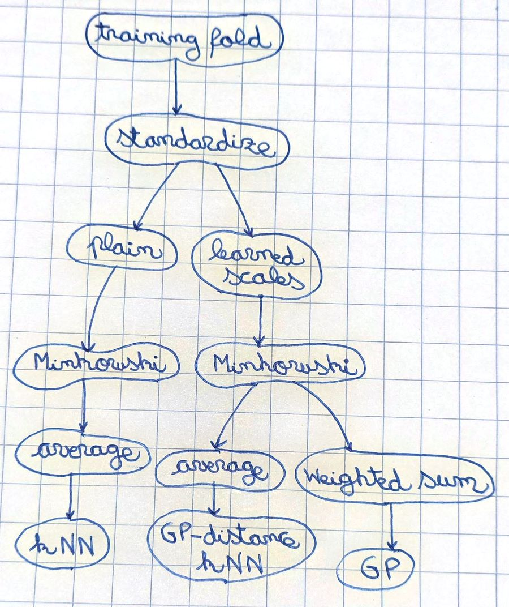

# Analysis

This folder has the code that builds our datasets and runs the experiments on them, plus their configs and results. For the project and the training runs, see the [main README](../README.md).

## Contents

- [Layout](#layout)
- [Environment](#environment)
- [Data](#data)
  - [Group 10](#group-10)
  - [Group 15](#group-15)
- [Experiments](#experiments)
- [Forest](#forest)
  - [Running the forest](#running-the-forest)
  - [Tuning the forest](#tuning-the-forest)
- [MLP](#mlp)
  - [Running the MLP](#running-the-mlp)
  - [Tuning the MLP](#tuning-the-mlp)
- [Regression forest](#regression-forest)
  - [Running the regression forest](#running-the-regression-forest)
  - [Tuning the regression forest](#tuning-the-regression-forest)
- [GPR](#gpr)
  - [Running the GPR](#running-the-gpr)
  - [Tuning the GPR](#tuning-the-gpr)
- [kNN](#knn)
  - [Running the kNN](#running-the-knn)
  - [Tuning the kNN](#tuning-the-knn)
- [Temperature](#temperature)
- [Checks](#checks)

## Layout

```
core/
  cv.py               folds, cross-validation and metrics
  experiment.py       configs, data loading, evaluation, results and tuning
datasets/
  group10.py          builds data/group10.csv
  group15.py          builds data/group15.csv
  outcomes.py         reached_95 and steps_to_95 from the reward curves
forest/
  forest.py           our ID3 forest
  run.py              cross-validates the forest
  tune.py             tunes the forest
  regression.py       our regression forest
  regression_run.py   cross-validates the regression forest
  regression_tune.py  tunes the regression forest
mlp/
  network.py          our MLP
  run.py              cross-validates the network
  tune.py             tunes the network
gpr/
  gpr.py              our Gaussian process regression
  run.py              cross-validates the GPR
  tune.py             tunes the GPR
knn/
  knn.py              our kNN
  run.py              cross-validates the kNN
  tune.py             tunes the kNN
temperature/
  cells.py            groups our runs by learning rate and batch size
configs/              experiment settings, one TOML file per experiment
results/              what each experiment wrote
requirements.txt      the pinned packages
```

Each model has its own folder with the model and two scripts, `run.py` and `tune.py`. The code they share is in `core/`. The scripts run as modules from the repository root, for example `python -m analysis.forest.run`. The regression forest shares `forest/` with the classifier, so its scripts are `regression_run.py` and `regression_tune.py`. `temperature/` holds no model, only the script behind the [temperature tables](#temperature).

## Environment

1) Create the environment in the repository root:

   ```powershell
   C:\path\to\python314\python.exe -m venv .venv
   ```

2) Activate it (needed in every new terminal):

   ```powershell
   Set-ExecutionPolicy -Scope Process -ExecutionPolicy Bypass -Force
   .\.venv\Scripts\Activate.ps1
   ```

3) Install the pinned packages:

   ```powershell
   python -m pip install -r analysis\requirements.txt --extra-index-url https://download.pytorch.org/whl/cpu
   ```

## Data

Each dataset has a script in `datasets/` that writes a CSV to `data/`. A config names the CSV it uses.

### Group 10

`analysis/datasets/group10.py` reads our run log (`data/group10_2026.csv`), the ML-Agents config of each logged run (`data/configs/`) and its training curve (`data/curves/`), and writes `data/group10.csv`: one row per PPO run on 3DBall with a budget of 500k steps (2,400 runs). The four 100k test runs in the log are left out.

The runs come from twelve batches of 50 configs, drawn with batch seeds 42 to 51, 60 and 80, on four laptops: m01, m02, m03 and m05 (`docs/hardware/machines.csv`). Each config ran with seeds 2 and 3 and with both balls, so each ball has 1,200 runs. The fixed ball has mass 1 and scale 1 (ML-Agents' `config/ppo/3DBall.yaml`). The random ball gets a new mass between 0.5 and 10 and a new scale between 0.75 and 3 at the start of every episode (`config/ppo/3DBall_randomize.yaml`). The `ball` column is `random` when the run's config has an `environment_parameters` block, and `fixed` otherwise.

Nine configs were drawn twice, in different batches, so there are 591 distinct configs. For seven of them, both copies ran on our Intel laptops, m01, m02 and m05, and runs with the same seed and ball have identical curves, so 28 runs copy others. For the other two, one copy ran on m03, an Apple M4: its curves differ from the first summary, and one of the two configs reaches 95 at different steps. So a run is reproducible from its config and seed on the Intel laptops, but not on the M4. Since `group10_steps_to_95.toml` groups runs by their settings, runs of the same config always share a fold. One run, `3DBallRandomize_b60_c00_s2`, has no curve in `data/curves/`, so its three outcome columns are empty.

The curves come from the TensorBoard files in `results/`, which exist only on the machine that ran the batch. After a new batch, export the new curves from the repository root, with the ML-Agents virtual environment (`external\ml-agents\venv`) active:

```powershell
python tools\export_curves.py
```

Then build the dataset, with `.venv` active:

```powershell
python -m analysis.datasets.group10
```

Each row has the run's ball, its 12 PPO settings (our batches vary 8 of them), its budget, its seed, the machine it ran on and the same three outcome columns as Group 15, computed the same way (`datasets/outcomes.py`).

The CSV is committed. Rerunning the script should leave `git diff` empty.

### Group 15

`analysis/datasets/group15.py` reads `Group15_data.7z` from the data submodule and writes `data/group15.csv`: one row per PPO run on 3DBall with a budget of 500k, 1M or 2M steps (1,555 runs).

From the repository root, with `.venv` active:

```powershell
python -m analysis.datasets.group15
```

Each row has the run's 12 PPO settings, its budget (`max_steps`), the machine it ran on and three outcome columns:

- `last_logged_step`: the last step the run logged
- `reached_95`: whether the mean reward reached 95 within the budget; empty if the run stopped early without reaching it
- `steps_to_95`: the first logged step with a mean reward of 95 or more; empty otherwise

The CSV is committed. Rerunning the script should leave `git diff` empty.

Data: Group 15 (AY 2025-2026), from the course's shared data repository (Apache License 2.0).

## Experiments

An experiment is one TOML config in `configs/<model>/`. To run a new experiment, add a config file. A model's `run.py` cross-validates it on the dataset the config names, and its `tune.py` tunes it.

A config sets:

- `data`: the CSV, relative to the repository root
- `target`: the column to predict
- `features`: the columns the model learns from
- `split_by` (optional): the column whose values each get their own cross-validation (`max_steps` in our split Group 15 configs, so one per budget, and `ball` in `group10_steps_to_95.toml`, so one per ball); without it, one cross-validation covers all runs
- `report_by` (optional): a column to break the results down by (`max_steps` in our pooled configs); the cross-validation stays the same
- `group_by`: the columns that make up a configuration; runs with the same values always share a fold
- `[cross_validation]`: `folds` (at most the number of configurations) and `seed`
- a table named after the model, such as `[forest]`, with the model's settings

The results go to `analysis/results/<model>/<config name>/`. `folds.csv` has each model's score on each fold, for each value of `split_by`. Without `split_by`, the first column is `split`, with the value `all`. With `report_by`, `folds_by_<column>.csv` has the same scores for each of that column's values, so a pooled config's results compare directly with a split config's.

`tune.py` tries every combination of the values listed in the config's `[tuning]` table, separately for each value of `split_by` if the config has one. It picks the combination with the best mean score on a grouped cross-validation, then reports that choice on fresh folds that were not used for choosing. It uses every CPU core; `--workers` sets a lower number.

The `[tuning]` table sets:

- `folds` and `seed`: the cross-validation used for choosing
- `report_folds` and `report_seed`: the fresh cross-validation used for reporting
- the values to try for each of the model's settings

The tuning results go to `analysis/results/<model>/<config name>/tuned_best_mean/`: `candidates.csv` has every combination's tuning score and rank, `summary.csv` the chosen setting with its tuning and report scores, `progress.jsonl` every combination's score on each tuning fold, and the other files the report run. A combination whose training diverged has an empty tuning score and shares the last rank.

`tune.py` saves each finished combination to `progress.jsonl` as it goes. If a tuning stops, running the same command again continues where it stopped, and only the missing combinations run. Values can be added to or removed from the `[tuning]` lists in between. It refuses to continue if the data file or a setting the tuning scores depend on has changed, since the saved scores would no longer match. `--restart` starts over. It is also needed after a change to a model's code, which this check cannot see.

## Forest

`analysis/forest/run.py` predicts `reached_95` with our ID3 forest (`analysis/forest/forest.py`). It also runs scikit-learn's forest on the same folds, as a check. The score is balanced accuracy. Always predicting the more common class gives a balanced accuracy of 0.5.

The four configs in `analysis/configs/forest/` predict `reached_95` from the plan's 5 settings and from all 12. The split configs give each budget its own cross-validation. The pooled ones, ending in `_pooled`, use one cross-validation over all budgets, with `max_steps` as one more feature.

### Running the forest

From the repository root, with `.venv` active:

```powershell
python -m analysis.forest.run --config analysis\configs\forest\reached_95_12_settings.toml
```

The `[forest]` table sets `trees`, `attributes_per_tree` (at most the number of features), `seed`, and optionally `max_depth` (no limit if it is left out).

`confusion.csv` has our forest's confusion matrix for each value of `split_by`. With `report_by`, `confusion_by_<column>.csv` has it for each of that column's values.

### Tuning the forest

From the repository root, with `.venv` active:

```powershell
python -m analysis.forest.tune --config analysis\configs\forest\reached_95_12_settings.toml
```

The `[tuning]` table lists the values to try for `trees`, `attributes_per_tree` and `max_depth`, with `"none"` for no depth limit. For the split configs, `tuned_two_se/` holds the first tuning run, which used a tie rule (within two standard errors of the best, the simplest wins) on a 5-fold cross-validation; on our data that rule chose forests that were too shallow.

## MLP

`analysis/mlp/` predicts `steps_to_95` with our network (`analysis/mlp/network.py`): fully connected hidden layers with batch norm, ReLU and optional dropout, trained with plain SGD on the mean squared error. It also scores three other models on the same folds:

- scikit-learn's `MLPRegressor` with the same settings, as a check on our network
- ridge regression on the same inputs, a linear model
- the median of the training runs, the baseline that ignores the settings

The score is the mean absolute error, averaged over the seeds for the two networks.

`MLPRegressor` has no dropout. With `dropout` above 0, scikit-learn's network trains without it, so it is no longer a check on the same model.

The configs in `analysis/configs/mlp/` predict `steps_to_95`. Four use Group 15's data, with the plan's 5 settings or all 12, split and pooled like the forest's. `group10_steps_to_95.toml` uses our runs, with the 8 settings our batches vary, split by `ball`. `group10_steps_to_95_extended.toml` and `group10_steps_to_95_edges.toml` are the same config with other tuning grids (see [Tuning the MLP](#tuning-the-mlp)). Only runs that reached 95 have a `steps_to_95`, so only they are used: 805 of Group 15's 1,555 runs, 1,156 of our 1,200 fixed-ball runs and 1,147 of our 1,200 random-ball runs. The configs take the natural log of the target and of the settings that span a factor of 8 or more (and of `max_steps` in the pooled configs), so an error of 0.1 means a typical prediction is about 10% off.

### Running the MLP

From the repository root, with `.venv` active:

```powershell
python -m analysis.mlp.run --config analysis\configs\mlp\steps_to_95_12_settings.toml
```

The `[mlp]` table sets `hidden_sizes` (one number per hidden layer), `learning_rate`, `batch_size`, `epochs`, `seeds` (each network is trained once per seed), and optionally `dropout` (the chance that each hidden neuron is dropped in a training step, 0 if it is left out). Three more keys are for the MLP only:

- `log_target`: `true` takes the natural log of the target
- `log_features`: the features to take the natural log of
- `median_by` (optional): the baseline takes its median separately for each value of this feature (`max_steps` in our pooled configs, so one per budget); without it, one median covers each split

### Tuning the MLP

From the repository root, with `.venv` active:

```powershell
python -m analysis.mlp.tune --config analysis\configs\mlp\steps_to_95_12_settings.toml
```

The `[tuning]` table lists the values to try for `hidden_sizes`, `learning_rate`, `batch_size`, `epochs` and `dropout`. All five are needed; `dropout = [0.0]` means no dropout. Only our network is tuned. The lowest mean error wins, and ties go to fewer layers, then fewer neurons, fewer epochs, larger batches, the lower learning rate and finally less dropout. The report run then scores all four models, with scikit-learn's network using the chosen settings.

Our runs were tuned in three steps, one config each. We built the second and third grids from earlier tunings on fewer runs, then reran all three on the 2,400 runs. The numbers here are from the reruns. `group10_steps_to_95.toml` chose values at the edges of its grid: the smallest batch on both balls, and the smallest network and the most epochs on the fixed ball. `group10_steps_to_95_extended.toml` tries values past those edges, drops a few others and adds dropout: 1,125 combinations per ball, which took about 9 hours 30 minutes on m01. On both balls it chose one hidden layer of 32, a learning rate of 0.03, 480 epochs and dropout 0.1, with a batch of 64 on the fixed ball and 32 on the random ball. `group10_steps_to_95_edges.toml` keeps one hidden layer of 32 and tries larger batches, more epochs and dropout around 0.1: 54 combinations per ball, which took about 44 minutes on m01. Its choices have a lower tuning error than the extended grid's on both balls.

It chose a learning rate of 0.03 and 960 epochs on both balls, with a batch of 128 and dropout 0.1 on the fixed ball and a batch of 64 and dropout 0.05 on the random ball. These still sit at some of its edges, such as 960 epochs on both balls. But compared with the extended grid's choices, they lowered the report error by only 0.0002 on the fixed ball and less than 0.0001 on the random ball, far less than the standard error of that difference (about 0.001), so we stopped there. They are the final MLP settings for our runs. Over the three steps, the report error fell from 0.218 to 0.212 on the fixed ball and from 0.222 to 0.212 on the random ball.

## Regression forest

`analysis/forest/regression.py` predicts `steps_to_95` with a regression version of our ID3 forest. It reuses the bootstrap, the attribute draw and the tree walk from `forest.py`, and changes four things:

- a split is scored by how much it lowers the variance of the target, instead of the entropy
- a leaf predicts the mean of its runs, instead of the majority class
- the forest predicts the mean of its trees, instead of the vote
- a split must leave at least `min_leaf` runs on each side

`sampling` sets how the attributes are drawn. With `"tree"`, each tree draws `attributes_per_tree` of them once, as `forest.py` does. With `"split"`, they are drawn again at every split, as in Breiman's random forest. With all 8 attributes, both are plain bagging.

Each split is found in one pass over the runs sorted by the attribute, with a running count and sum on each side (`best_split_point_fast`). `best_split_point` finds the same split the slow way and is kept as a check. The derivation is in [docs/reading/regression.md](../docs/reading/regression.md).

It also runs scikit-learn's forest on the same folds, as a check: `RandomForestRegressor` for `"split"` and `BaggingRegressor` over decision trees for `"tree"`. The score is the mean absolute error, as for the MLP.

`analysis/configs/forest/group10_steps_to_95.toml` uses the same data, target, settings, groups and fold seeds as the MLP's `group10_steps_to_95.toml`, so the two models' scores compare fold by fold. It takes the natural log of the target only, because a tree splits a logged setting the same way as the original.

### Running the regression forest

From the repository root, with `.venv` active:

```powershell
python -m analysis.forest.regression_run --config analysis\configs\forest\group10_steps_to_95.toml
```

The `[forest]` table sets `trees`, `attributes_per_tree` (at most the number of features), `seed`, and optionally `max_depth` (no limit if it is left out), `min_leaf` (1 if it is left out) and `sampling` (`"split"` if it is left out). `log_target` and `log_features` work as for the MLP.

### Tuning the regression forest

From the repository root, with `.venv` active:

```powershell
python -m analysis.forest.regression_tune --config analysis\configs\forest\group10_steps_to_95.toml
```

The `[tuning]` table lists the values to try for `trees`, `attributes_per_tree`, `max_depth` (with `"none"` for no depth limit), `min_leaf` and `sampling`. The lowest mean error wins, and ties go to the shallower tree, then larger leaves, fewer attributes, more trees and finally `"split"`. The report run then scores both forests with the chosen settings. Our config tries 300 combinations per ball, which took about 16 minutes on m01.

## GPR

`analysis/gpr/` predicts `steps_to_95` with our Gaussian process regression (`analysis/gpr/gpr.py`). To predict a config, it takes a weighted sum of the training runs' targets, and runs whose settings are close to the config's count the most. A kernel sets how fast the weight falls as two configs get further apart. Each prediction also comes with a standard deviation (`predict(..., return_std=True)`), which the scripts do not use yet. It also scores scikit-learn's `GaussianProcessRegressor` with the same kernel on the same folds, as a check. The score is the mean absolute error, as for the MLP.

The kernel has a length scale for each setting (`ard = true`) or one for all of them, a signal variance and a noise variance. The noise variance is the part of a run's result that its settings cannot explain, such as the gap between seeds 2 and 3 of the same config. Our GPR scales each feature and the target to mean 0 and standard deviation 1, then picks these values by maximizing the log marginal likelihood of the training runs, with L-BFGS on gradients from torch. So they need no cross-validation. At the same kernel values, its log marginal likelihood and predictions match scikit-learn's to about 1e-10. The comments in the code follow Rasmussen and Williams (2006), *Gaussian Processes for Machine Learning*.

`analysis/configs/gpr/group10_steps_to_95.toml` uses the same data, target, settings, logs, groups and fold seeds as the MLP's `group10_steps_to_95.toml`, so the models' scores compare fold by fold. Unlike for the forest, taking the log of the wide settings matters here, because the GPR works on distances.

### Running the GPR

From the repository root, with `.venv` active:

```powershell
python -m analysis.gpr.run --config analysis\configs\gpr\group10_steps_to_95.toml
```

The `[gpr]` table sets `kernel` (`"rbf"`, `"matern52"` or `"matern32"`; `"matern52"` if it is left out), `ard` (`true` if it is left out) and `steps`, the most L-BFGS iterations (200 if it is left out). `log_target` and `log_features` work as for the MLP.

Besides `folds.csv`, it writes `length_scales.csv`: what our GPR learns from all runs of each split. A short length scale means the result changes quickly with that setting, so the setting matters more. A very long one means it barely matters. The length scales are in standard deviations of each (logged) setting. `noise_sd` is how far runs land from what their settings predict, and `signal_sd` how far the settings move the result, both in units of the logged target.

### Tuning the GPR

From the repository root, with `.venv` active:

```powershell
python -m analysis.gpr.tune --config analysis\configs\gpr\group10_steps_to_95.toml
```

The `[tuning]` table lists the values to try for `kernel` and `ard`. The lowest mean error wins, and ties go to one shared length scale, then to the smoother kernel (`rbf`, then `matern52`, then `matern32`). The report run then scores both GPRs with the chosen settings, and `length_scales.csv` comes from the chosen settings. Our config tries 6 combinations per ball, which took about 12 minutes on m05 with 12 workers.

On both balls it chose `matern32` with a length scale for each setting. The report error is 0.206 on the fixed ball and 0.201 on the random ball. On both balls, `learning_rate` has the shortest length scale and `beta` by far the longest. `buffer_size` comes second on the random ball and third on the fixed ball, just behind `num_layers`.

The final MLP (the edges grid) and the regression forest are scored on the same 2,400 runs and report folds, so the three models compare fold by fold. The GPR has the lowest error of the three. It is lower than the final MLP's by 0.006 on the fixed ball and 0.011 on the random ball (on 7 and 9 of the 10 folds), and lower than the regression forest's by 0.022 and 0.027 (on all 20 folds).

## kNN

`analysis/knn/` predicts `steps_to_95` with our k-nearest neighbors (`analysis/knn/knn.py`). It scales each setting to mean 0 and standard deviation 1 on the training runs, so no setting counts more because of its units. To predict a config, it finds the `k` training runs whose settings are closest to the config's and takes the mean of their targets. Closeness is the Minkowski distance with power `p`. It also scores scikit-learn's `KNeighborsRegressor` on the same folds, as a check. The score is the mean absolute error, as for the MLP.

With `distance = "gpr"`, it also divides each scaled setting by the length scale our GPR learns for it on the same training runs. A setting with a short length scale then counts more in the distance, as in the GPR. Only the ratios between the length scales change which runs are closest.

<p align="center"></p>

The flowchart shows how the kNN, the kNN with the GPR's distance and the GPR relate. All three scale the settings on the training fold. The kNN gives every setting an equal weight, and the other two use the GPR's length scales. The two kNNs take the mean of the `k` closest runs, and the GPR a weighted sum of all of them.

`analysis/configs/knn/group10_steps_to_95.toml` uses the same data, target, settings, logs, groups and fold seeds as the GPR's `group10_steps_to_95.toml`, so their scores compare fold by fold. As for the GPR, taking the log of the wide settings matters, because the kNN works on distances. `group10_steps_to_95_gpr_distance.toml` is the same config with `distance = "gpr"`.

### Running the kNN

From the repository root, with `.venv` active:

```powershell
python -m analysis.knn.run --config analysis\configs\knn\group10_steps_to_95.toml
```

The `[knn]` table sets:

- `k`: how many of the closest runs to average (5 if it is left out)
- `p`: the power of the Minkowski distance, at least 1 (2 if it is left out); 1 is the Manhattan distance, 2 the Euclidean distance and `inf` the largest difference in any one setting
- `distance`: `"standard"` or `"gpr"` (`"standard"` if it is left out)
- `kernel` and `steps`: for `"gpr"`, the kernel and the most L-BFGS iterations of the GPR behind the distance, as in the `[gpr]` table (`"matern32"` and 200 if they are left out); this GPR always has a length scale for each setting

`log_target` and `log_features` work as for the MLP.

When several runs tie at the k-th place, such as the two seeds of one config, our kNN and scikit-learn's can keep different ones. So their errors are close but not equal. In our results, the mean errors differ by at most 0.0012, and single folds by up to 0.017.

### Tuning the kNN

From the repository root, with `.venv` active:

```powershell
python -m analysis.knn.tune --config analysis\configs\knn\group10_steps_to_95.toml
```

The `[tuning]` table lists the values to try for `k` and `p`. Only our kNN is tuned. The lowest mean error wins, and ties go to more neighbors, then to `p = 2`. The report run then scores both kNNs with the chosen settings. Our config tries 20 combinations per ball, which took under a minute on m01. The GPR-distance config tries only `p = 2`, so 10 combinations per ball. It took about 14 minutes on m01, because each fold first fits a GPR.

With equal weights, it chose `k = 8` and `p = 1` on the fixed ball and `k = 13` and `p = 2` on the random ball. The report error is 0.273 on the fixed ball and 0.276 on the random ball. With the GPR's distance, it chose `k = 20` on the fixed ball and `k = 8` on the random ball, and the report error is 0.256 and 0.260.

The GPR's report error is lower than the kNN's by 0.067 on the fixed ball and 0.075 on the random ball. To see where this lead comes from, `analysis/configs/gpr/group10_steps_to_95_shared_scale.toml` uses one length scale for all settings (`ard = false`). Its tuning grid has only this one setting, so tuning it just gives its report error on the same folds. The four models then differ in two steps: how the settings are weighted and how the targets are averaged.

| Report error, fixed / random | Mean of the `k` closest runs | Weighted sum of all runs |
|---|---|---|
| Equal weights | 0.273 / 0.276 (kNN) | 0.213 / 0.208 (GPR, one length scale) |
| The GPR's length scales | 0.256 / 0.260 (kNN, GPR distance) | 0.206 / 0.201 (GPR) |

The length scales lower the error by 0.017 and 0.016 for the kNN, and by 0.007 on both balls for the GPR, on 7 to 9 of the 10 folds. The weighted sum lowers it by 0.060 and 0.068 with equal weights, and by 0.050 and 0.059 with the length scales, on all 10 folds of both balls. So most of the GPR's lead comes from how it averages, not from how it measures distance.

## Temperature

`analysis/temperature/cells.py` groups our runs by ball, learning rate and batch size. It is a first check of the idea in [docs/reading/temperature.md](../docs/reading/temperature.md) that the learning rate and the batch size act together, like a temperature. For each group, it gives:

- the number of runs and the share that never reached 95
- the median steps to 95 of the runs that reached it
- the median gap in ln(`steps_to_95`) between seeds 2 and 3 of the same config, for configs where both reached 95
- lr/B and lr/√B (lr the learning rate, B the batch size), the two candidate temperatures from the note

It also sums up each learning rate over all batch sizes, and gives the learning rate with the lowest median for each batch size.

From the repository root, with `.venv` active:

```powershell
python -m analysis.temperature.cells
```

It has no config. It reads `data/group10.csv`, prints the tables for each ball and writes `cells.csv`, `by_learning_rate.csv` and `best_learning_rate.csv` to `analysis/results/temperature/`.

On both balls, the runs with a learning rate of 0.003, the highest we tried, need the most steps and most often never reach 95. Larger batches lower that share: from 24.5% with a batch of 32 to 2.5% with a batch of 256 on the fixed ball, and from 26.4% to 3.8% on the random ball.

## Checks

- shuffled targets: train on targets shuffled at random; the score should fall to the baseline, which shows that nothing leaks from the test folds into training
- permutation importance: shuffle one feature at a time in the test folds and measure how much the score drops, which shows the settings a model relies on
- learning curve: train on growing parts of the training folds and score on the same test folds; if the error is still falling with all the runs, more runs would help
