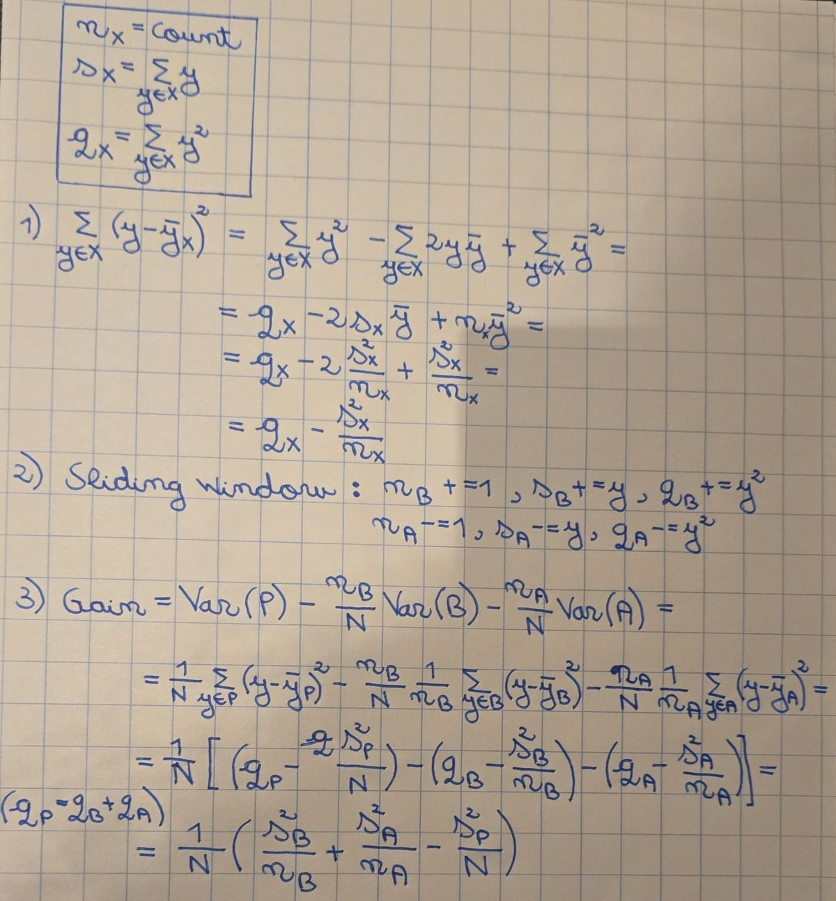

# From ID3 forest to regression forest - implementation notes

## From entropy to variance

**Entropy (classifier):** how mixed the classes in a node are

$$E(S) = -\sum_{i=1}^{n} p_i \log_n p_i$$

**Variance (regression):** how spread out the targets in a node are

$$\mathrm{Var}(S) = \frac{1}{|S|} \sum_{y \in S} (y - \bar{y})^2 \qquad \bar{y} = \frac{1}{|S|} \sum_{y \in S} y$$

- $S$: the runs in a node
- $y$: the target of one run, ln(steps_to_95)
- $\bar{y}$: the mean of the targets, the node's prediction

**Why the mean:** a node gives all its runs one prediction, and no number has a smaller squared error than the mean

**What the variance measures:** the average squared miss of that prediction
- low: the runs took similar numbers of steps, a good leaf
- high: the runs disagree, a split may separate them

**Why square:** positive and negative misses do not cancel, and big misses count more

**Example:** targets 11.0, 11.3, 11.9
- mean: (11.0 + 11.3 + 11.9) / 3 = 11.4
- squared misses: 0.16, 0.01, 0.25, sum 0.42
- variance: 0.42 / 3 = 0.14

## How to find the best split for a certain attribute faster?

### Understanding the problem

Intuitively, to calculate the best split point for a certain attribute, we roughly:

```text
sort the runs by value, each target staying with its value
best_gain = 0, best_split = none
for each pair of neighbouring runs, from start to finish:
    if their values differ:
        candidate = the midpoint of the two values
        below = the targets up to the candidate, above = the targets after it
        compute the variance of below and of above
        gain = variance of all targets minus the weighted variances of below and above
        if gain > best_gain:
            best_gain = gain, best_split = candidate
return best_split, best_gain
```

To optimize, we need to identify what is calculated at each step, and try to do it globally, on the go.
That is the variance of the current below and above.

### Mathematical proof 



### Optimization 

```text
sort the runs by value, each target staying with its value
below_n = 0, below_sum = 0
above_n = number of runs, above_sum = sum of all targets
k = above_sum² / above_n, computed once for the whole node
best_gain = 0, best_split = none
for each run except the last, from start to finish:
    move its target y from above to below:
        below_n + 1, below_sum + y, above_n - 1, above_sum - y
    if its value differs from the next run's value:
        candidate = the midpoint of the two values
        gain = (below_sum² / below_n + above_sum² / above_n - k) / number of runs
        if gain > best_gain:
            best_gain = gain, best_split = candidate
return best_split, best_gain
```

## min_leaf

**What it is:**
- the smallest number of runs a leaf may hold
- a split is only allowed if both sides keep at least that many runs

**What a tiny leaf does:**
- without a limit, a regression tree keeps splitting until a leaf holds very few runs, sometimes one
- that leaf predicts that run's value, luck included

**What a bigger leaf does:** a leaf of $k$ runs predicts their mean, and the luck partly cancels

**Why `max_depth` isn't enough:** `max_depth` limits how many splits sit on a path, but even a shallow split can still cut off a single unlucky run

## Draw per-tree or per-split

**Per-split (Breiman's random forest):**
- every node draws a fresh $m$ attributes from all of them

**Per-tree:**
- each tree draws $m$ attributes once, and every node of that tree tries the same $m$

**Why both:**
- faster to implement & try both rather than reason which one is better before results